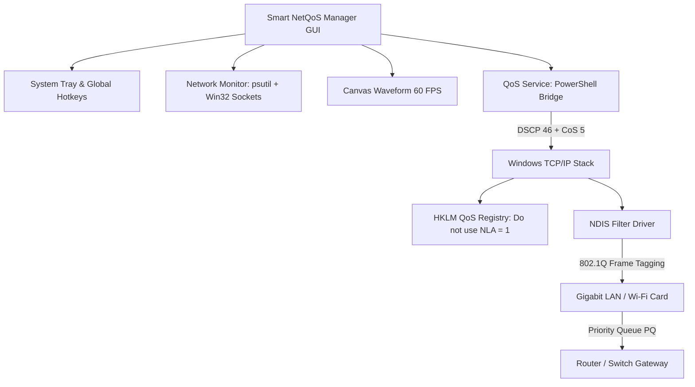

# ⚡ Smart NetQoS Manager

<p align="center">
  
</p>

<p align="center">
  <strong>Trình Quản Lý Phân Luồng Mạng Thông Minh & Giám Sát Băng Thông Thời Gian Thực Cho Windows 10/11</strong>
</p>

<p align="center">
  <a href="https://github.com/Tung31082005/Smart-NetQoS/releases"></a>
  <a href="https://www.python.org/"></a>
  <a href="https://github.com/TomSchimansky/CustomTkinter"></a>
  <a href="LICENSE"></a>
  <a href="#"></a>
  <a href="#"></a>
</p>

---

## 📖 Giới Thiệu (Overview)

Khi bạn đang chơi game đối kháng căng thẳng, họp trực tuyến (Discord, Zoom), hoặc tải mô hình AI qua Antigravity / Cursor, chỉ cần một tiến trình nền (Windows Update, Steam, IDM, trình duyệt tải video...) giật băng thông là toàn bộ mạng sẽ bị **ping spike**, **jitter** và **bufferbloat**.

**Smart NetQoS Manager** là giải pháp phần mềm Mini Dashboard hiện đại, chạy ngầm tĩnh lặng dưới Windows System Tray. Ứng dụng can thiệp trực tiếp vào tầng mạng TCP/IP của Windows thông qua chính sách **NetQosPolicy**, tự động gán nhãn ưu tiên phần cứng **DSCP 46 (Expedited Forwarding)** và **IEEE 802.1p CoS 5 (Voice/Interactive Priority)** cho các ứng dụng bạn muốn, đồng thời hiển thị biểu đồ sóng lưu lượng thời gian thực với mức tiêu thụ CPU gần như bằng **0.00%**.

---

## ✨ Tính Năng Nổi Bật (Key Features)

- 📈 **Biểu Đồ Sóng 60 FPS (Real-time Waveform Canvas):**
  - Trực quan hóa tốc độ Download (Sóng xanh Cyan) và Upload (Đường cam) với thuật toán làm mịn động (auto-scaling) và hiển thị tốc độ đỉnh tức thời.
- ⚡ **Sắp Xếp Động Kiểu Task Manager (Dynamic Sorting):**
  - Mọi ứng dụng đang phát sinh tải dữ liệu mạng (`io_rate > 0`) sẽ **ngay lập tức nhảy vọt lên top đầu** danh sách, giúp bạn nhìn thấy ngay ứng dụng nào đang chiếm dụng mạng nhiều nhất.
- ⭐ **Gán Quyền VIP 1-Click (Interactive QoS Tagging):**
  - Nhấp nút `[Đặt VIP]` trên bất kỳ ứng dụng nào hoặc thêm qua tên file `.exe` / File Explorer. App sẽ gán tag DSCP 46 / CoS 5 xuống NDIS Driver để Router ưu tiên gói tin đi trước không độ trễ.
- 🎯 **3 Chế Độ Hiệu Chuẩn Sẵn (Calibrated Quick Modes):**
  - **⚡ AI Dev Mode:** Khóa VIP cho *Antigravity, Chrome, Node.js, Python, VS Code, Git, Language Server*.
  - **🎮 Gaming Mode:** Tập trung toàn bộ ưu tiên DSCP cho *Valorant, CS2, LMHT, Dota 2, Genshin Impact, Overwatch, Discord, Steam*.
  - **🚀 Max Download:** Cấp toàn bộ throughput cho *IDM, qBittorrent, Steam, Epic Games Launcher, Chrome*.
- ⌨️ **Phím Tắt Toàn Cầu (Global Hotkeys):**
  - Đổi chế độ ngay lập tức kể cả khi đang full-screen chơi game:
    - `Ctrl + Shift + 1`: Kích hoạt **AI Dev Mode**
    - `Ctrl + Shift + 2`: Kích hoạt **Gaming Mode**
    - `Ctrl + Shift + 3`: Kích hoạt **Max Download**
    - `Ctrl + Shift + Q`: Bật / Ẩn nhanh cửa sổ điều khiển
- 🔌 **Tự Động Nhận Diện Cáp LAN & Wi-Fi:**
  - Nhận diện card mạng thời gian thực: Hiển thị huy hiệu `🔌 Cáp LAN (1 Gbps)` hoặc `📶 Wi-Fi (866 Mbps)`.
  - Hỗ trợ đầy đủ full-duplex Gigabit Ethernet với độ trễ gateway $< 1\text{ ms}$.
- 🔍 **Chi Tiết Kết Nối Socket (Socket Inspector):**
  - Bấm vào biểu tượng kính lúp 🔍 bên cạnh tên app để xem danh sách IP từ xa, cổng kết nối (Remote Port) và trạng thái kết nối đang mở.
- 🪶 **Tối Ưu Siêu Nhẹ (0.00% CPU):**
  - Ngắt toàn bộ vòng lặp vẽ canvas khi app thu nhỏ về System Tray.
  - Sử dụng Win32 Kernel Event `GetMessageW` thay vì polling liên tục; loại bỏ hoàn toàn việc quét vét `psutil.process_iter()`.
- 🛡️ **Nâng Quyền Tự Động Ẩn (Silent Elevation):**
  - Tích hợp chuẩn Base64 `-EncodedCommand` cho PowerShell, tự động nâng quyền khi đổi cờ VIP mà không gây crash, không hiện cửa sổ console đen chớp nháy.

---

## 🛠️ Kiến Trúc Kỹ Thuật (Architecture & Under the Hood)



### 1. Cơ chế DSCP & 802.1p
- **DSCP 46 (Expedited Forwarding - EF):** Giá trị DSCP cao nhất dành cho lưu lượng thời gian thực tương tác, bảo đảm router chuyển tiếp gói tin vào hàng đợi ưu tiên cao nhất (Strict Priority Queue).
- **802.1p CoS 5:** Gán nhãn trực tiếp vào frame Ethernet tầng 2 (L2), giúp Switch phần cứng và card mạng xử lý trước ngay cả khi mạng nội bộ bị nghẽn.

### 2. Sửa lỗi Windows Home/Workgroup NLA
Mặc định, Windows 10/11 sẽ lờ đi các chính sách DSCP nếu máy tính không gia nhập miền Active Directory (Domain). Ứng dụng khắc phục triệt để bằng khóa Registry:
```powershell
Set-ItemProperty -Path "HKLM:\SYSTEM\CurrentControlSet\Services\Tcpip\QoS" -Name "Do not use NLA" -Value "1" -Type String
```

---

## 📥 Cài Đặt (Installation)

### Yêu cầu hệ thống:
- Hệ điều hành: Windows 10 hoặc Windows 11 (64-bit).
- Python: Phiên bản 3.10 trở lên.
- PowerShell 5.1 hoặc PowerShell 7.

### Các bước cài đặt:

1. **Clone repository về máy:**
   ```bash
   git clone https://github.com/Tung31082005/Smart-NetQoS.git
   cd Smart-NetQoS
   ```

2. **Cài đặt các thư viện phụ thuộc:**
   ```bash
   pip install -r requirements.txt
   ```

3. **Tạo phím tắt ra màn hình Desktop (Tùy chọn):**
   - Chạy file `create_desktop_shortcut.bat` bằng cách nhấp đúp chuột.
   - Một shortcut mang tên **Smart NetQoS Manager** kèm logo tia sét sẽ xuất hiện trên Desktop của bạn.

---

## 🚀 Khởi Chạy (Usage)

- **Cách 1 (Khuyên dùng):** Nhấp đúp vào shortcut **Smart NetQoS Manager** trên Desktop hoặc chạy file `launcher.vbs`. Ứng dụng sẽ khởi chạy 100% êm ái không hề nháy cửa sổ đen cmd.
- **Cách 2:** Chạy file `run_app.bat`.
- **Cách 3 (Dòng lệnh):**
  ```bash
  pythonw app.py
  ```
  *(Thêm cờ `--minimized` nếu muốn app tự động ẩn ngay vào System Tray khi khởi động cùng Windows).*

---

## 📁 Cấu Trúc Dự Án (Project Structure)

```
Smart-NetQoS/
├── assets/
│   ├── icon.ico                # Icon định dạng ICO đa kích thước
│   └── icon.png                # Icon PNG độ phân giải cao
├── app.py                      # Giao diện chính CustomTkinter + System Tray
├── net_monitor.py              # Bộ lắng nghe socket, đo lưu lượng, ping và sort
├── qos_service.py              # Quản lý chính sách NetQosPolicy & Ethernet/Wi-Fi
├── traffic_graph.py            # Canvas 60 FPS vẽ đồ thị sóng Download / Upload
├── icon_manager.py             # Trích xuất icon native của file .exe qua Win32 API
├── config_manager.py           # Quản lý lưu trữ cấu hình JSON
├── config.json                 # Tệp lưu cấu hình người dùng
├── launcher.vbs                # Script khởi chạy ngầm 100% không flash console
├── run_app.bat                 # File thực thi kiểm tra quyền Admin
├── create_desktop_shortcut.bat # Script tạo phím tắt Desktop
├── requirements.txt            # Danh sách thư viện Python cần thiết
├── LICENSE                     # Giấy phép mã nguồn mở Apache-2.0
└── README.md                   # Tài liệu hướng dẫn sử dụng
```

---

## 🤝 Đóng Góp (Contributing)

Mọi đóng góp nhằm tối ưu thuật toán QoS, cải tiến giao diện hoặc bổ sung các preset mới đều rất được hoan nghênh!
1. Fork dự án.
2. Tạo nhánh tính năng (`git checkout -b feature/AmazingFeature`).
3. Commit thay đổi (`git commit -m 'Add some AmazingFeature'`).
4. Push lên nhánh (`git push origin feature/AmazingFeature`).
5. Tạo một Pull Request mới.

---

## 📄 Giấy Phép (License)

Dự án được phân phối dưới giấy phép mã nguồn mở **Apache License 2.0**. Xem tệp [LICENSE](LICENSE) để biết thêm thông tin chi tiết.

---

<p align="center">
  Được phát triển với ❤️ bởi <a href="https://github.com/Tung31082005">Nguyễn Thanh Tùng</a>
</p>
